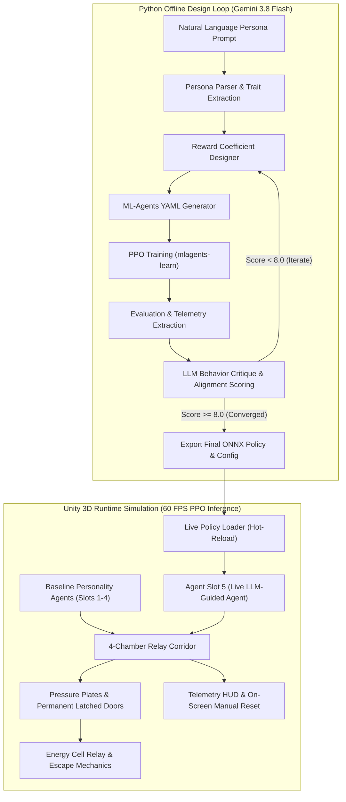

# PersonalityAgents: Closed-Loop LLM-Mediated Cooperative Relay Simulation

A comprehensive, end-to-end multi-agent reinforcement learning (MARL) testbed in Unity and Python. The project explores the emergence, fine-tuning, and human-perceivable expression of diverse personality archetypes cooperating in a multi-chamber physical puzzle corridor.

---

## 1. Executive Summary & Architecture Overview

PersonalityAgents couples **Unity ML-Agents (PPO)** with an **offline closed-loop Large Language Model (Gemini) reward design and behavior critique pipeline**. Rather than manually tweaking complex reward formulations, researchers specify natural language agent personas (e.g., *"Reckless Charger: impatient, rushes ahead, pushes teammates to grab the energy cell"*). The system iteratively designs reward functions, trains policies, extracts telemetry, critiques emergent behaviors, and hot-reloads the policy into a live 3D Unity simulation.



### Core Architecture Highlights
- **Strict Separation of Concerns**: The LLM is **never** invoked at Unity runtime or inference time. Unity executes pure neural network inference via ONNX / Unity Inference Engine at 60 FPS. The LLM operates strictly offline in Python as a reward designer and behavioral judge.
- **4-Chamber Progressive Maze**: A clean linear corridor featuring an escalating cooperative puzzle hierarchy: 1 plate $\rightarrow$ 2 simultaneous plates $\rightarrow$ 3 simultaneous plates $\rightarrow$ delivery terminal.
- **Permanent Gate Latching**: Once all required pressure plates for a gate are stepped on simultaneously, the gate remains permanently open, eliminating tedious backtracking or oscillation.
- **Agent Escape System**: Agents reaching the destination chamber escape the corridor and are cleanly deactivated from the active puzzle.
- **On-Screen Manual Reset**: Timed episode resets are replaced by an interactive on-screen `[RESET ENVIRONMENT]` button, resetting all doors, plates, energy cell, and all 5 agents (including the live policy slot).
- **Light Studio Visual Aesthetic**: Modern light neutral studio background (`Color(0.82f, 0.85f, 0.89f)` / `#D1D9E3`) with semi-transparent frosted glass walls, glowing laser gates, expanding animated pad rings, and dark translucent HUD telemetry cards.

---

## 2. 4-Chamber Corridor Environment

### Physical Layout & Dimensions
The corridor is bounded within $[-15.0, 25.0]$ on the X axis ($40\,\text{m}$ total length) and $[-6.0, 6.0]$ on the Z axis ($12\,\text{m}$ total width).

| Chamber | X Bounds | Key Entities | Puzzle Requirement |
| :--- | :--- | :--- | :--- |
| **Chamber A** (Spawn Room) | $[-15.0, -5.0]$ | 5 Agent Spawns, Energy Cell, **Pad A** | Single agent stands on **Pad A** to unlock Gate 1 |
| **Chamber B** (Dual Coordination) | $[-5.0, 5.0]$ | **Gate 1**, **Pad B**, **Pad C** | Two agents must step on **Pad B** & **Pad C** simultaneously to unlock Gate 2 |
| **Chamber C** (Triple Puzzle Room) | $[5.0, 15.0]$ | **Gate 2**, **Pad D**, **Pad E**, **Pad F** | Three agents must step on **Pad D**, **Pad E**, & **Pad F** simultaneously to unlock Gate 3 |
| **Chamber D** (Goal & Escape) | $[15.0, 25.0]$ | **Gate 3**, **Receiver Terminal**, Escape Line | Energy cell delivered to terminal; agents reaching $X \ge 23.2\,\text{m}$ escape |

### Spatial Coordinate Map
```
X = -15m              X = -5m               X = +5m               X = +15m             X = +25m
+--------------------+--------------------+--------------------+--------------------+
|  Agent Spawns (5)  |      Pad C         |      Pad F         |                    |
|                    |     (0, 0, +3.5)   |    (10, 0, +3.8)   |                    |
|  Energy Cell       |      [Gate 1]      |      [Gate 2]      |      [Gate 3]      |  [Receiver]
|  (-13, 0.6, 0)     |     (-5, 0, 0)     |     (+5, 0, 0)     |    (+15, 0, 0)     |  (+24, 1, 0)
|                    |                    |      Pad E         |                    |  Escape: X>23.2m
|      Pad A         |      Pad B         |    (8.5, 0, 0)     |                    |
|  (-7.5, 0, -3.0)   |     (0, 0, -3.5)   |      Pad D         |                    |
|                    |                    |    (10, 0, -3.8)   |                    |
+--------------------+--------------------+--------------------+--------------------+
   <-- Chamber A -->    <-- Chamber B -->    <-- Chamber C -->    <-- Chamber D -->
```

---

## 3. Gameplay Mechanics & Interactions

### 1. Permanent Door Latching
In earlier iterations, doors closed immediately when agents stepped off pressure plates, requiring one agent to stay pinned on a plate forever while others moved ahead. In the current design:
- **Gate 1**: Latches open permanently once Pad A is pressed.
- **Gate 2**: Latches open permanently once Pad B and Pad C are pressed *simultaneously*.
- **Gate 3**: Latches open permanently once Pad D, Pad E, and Pad F are pressed *simultaneously*.
- **Implementation**: Managed by boolean latching flags (`isGate1PermanentlyOpen`, `isGate2PermanentlyOpen`, `isGate3PermanentlyOpen`) inside [`CorridorEnvironment.cs`](file:///C:/Program%20Files/Unity%20Projects/PersonalityAgents/Assets/Scripts/Environment/CorridorEnvironment.cs).

### 2. Agent Escape System
When an agent successfully navigates through all gates into the final chamber and crosses the threshold ($X \ge 23.2\,\text{m}$ or within $1.8\,\text{m}$ of the Receiver Terminal):
- The agent calls `ag.Escape()`.
- Its `HasEscaped` flag is marked `true`.
- The agent GameObject is deactivated from the active scene, cleanly visually representing that the agent has completed the mission and escaped.
- Works seamlessly for both baseline agents and the live policy agent.

### 3. On-Screen Manual Reset System
- Automatic episode timeout resets are disabled (`autoResetOnTimeout = false`).
- An interactive orange `[RESET ENVIRONMENT]` button is rendered prominently in the top right of the screen via [`CorridorHUD.cs`](file:///C:/Program%20Files/Unity%20Projects/PersonalityAgents/Assets/Scripts/UI/CorridorHUD.cs).
- Clicking the button invokes `CorridorEnvironment.ResetEnvironment()`, which:
  1. Resets episode step counters.
  2. Resets all pressure pads (`pad.ResetPad()`).
  3. Resets all gates to closed position and clears permanent latching flags.
  4. Respawns the Energy Cell with slight positional jitter in Chamber A.
  5. Reactivates and teleports all baseline agents back to Chamber A.
  6. **Fully resets the LLM-mediated agent** (Slot 5): reactivates its GameObject, zeroes linear/angular velocity, teleports it back to Chamber A, and calls `OnEpisodeBegin()`.

---

## 4. Visual Design & Aesthetics

The visual presentation adheres to high aesthetic standards:

| Element | Visual Treatment | Implementation Details |
| :--- | :--- | :--- |
| **Background** | Clean Light Studio Tone | `Color(0.82f, 0.85f, 0.89f)` (`#D1D9E3`) with `CameraClearFlags.SolidColor` |
| **Outer & Partition Walls** | Frosted Glass | Semi-transparent lit shader (`Color(0.06f, 0.085f, 0.12f, 0.62f)`), alpha-blended, high smoothness ($0.88$) |
| **Corridor Floor** | Dark Sci-Fi Grid | Deep charcoal base (`#0c0f16`) with subtle metallic grid lines and corner dots |
| **Laser Gates** | Neon Translucent Forcefields | Blue (Gate 1), Amber (Gate 2), Purple/Green (Gate 3), emissive vertical panels |
| **Pressure Plates** | Expanding Pulse Rings | Colored cylindrical pads with procedural expanding animated rings that pulse when active |
| **Agents** | Sleek Cylinders with Halos | Color-coded personality bodies, rotating floating ring halos, vertical light beams, and carrier auras |
| **HUD** | Dark Glassmorphic Cards | Deep slate translucent boxes (`Color(0.06f, 0.08f, 0.12f, 0.94f)`) providing high contrast against the light background |

---

## 5. Multi-Agent Personalities (Five Archetypes)

The simulation features five active agent slots operating under the Five-Factor (OCEAN) personality model:

```
+---------------------------------------------------------------------------------------------------+
| Slot   | Persona Name              | Trait Profile        | Color   | Primary Behavioral Tendency |
+--------+---------------------------+----------------------+---------+-----------------------------+
| Slot 1 | High-E Leader (Pusher)    | E+ (0.85), N- (0.15) | Yellow  | High speed, pushes forward  |
| Slot 2 | Agreeable Supporter       | A+ (0.90), E- (0.25) | Pink    | Holds pads, yields to team  |
| Slot 3 | Conscientious Courier     | C+ (0.88), A+ (0.70) | Orange  | Reliable carrier, safe path |
| Slot 4 | Erratic Solo Scout        | N+ (0.85), A- (0.20) | Cyan    | Wandering, sporadic actions |
| Slot 5 | Live LLM-Designed Agent   | Dynamic (Gemini)     | Green   | Custom trained policy slot  |
+---------------------------------------------------------------------------------------------------+
```

### Telemetry Metrics Tracked per Agent
1. **Speed ($u/\text{s}$)**: Mean velocity magnitude across the episode.
2. **Pad Hold Duration (steps)**: Total fixed update steps spent standing on pressure pads.
3. **Pushing Count**: Collision events against other agents with relative velocity $> 0.5\,\text{m/s}$.
4. **Carry Time (steps)**: Cumulative duration holding the Energy Cell.
5. **Delivery Success Rate ($\%$)**: Fraction of episodes resulting in valid terminal deposits.
6. **Mean Phase Reached ($1.0 - 5.0$)**: Average progression milestone through the corridor.

---

## 6. Closed-Loop LLM-Mediated Feedback Pipeline

The novelty of the pipeline lies in the **autonomous self-correcting reward design loop**:

### Mathematical Formulation
The net reward $R_t$ received by an agent at step $t$ is a weighted linear combination of task objectives and personality-shaping incentives:

$$R_t = \lambda_{\text{task}} R_{\text{task}}(t) + \lambda_{\text{persona}} \sum_{k=1}^{K} w_k \cdot \phi_k(s_t, a_t)$$

Where:
- $\phi_k$: Behavioral basis functions (e.g., proximity to cell, velocity along corridor, time on pad, contact forces with teammates).
- $w_k$: Continuous coefficient vector designed and adapted by the LLM.
- $\lambda_{\text{task}}, \lambda_{\text{persona}}$: Dynamic curriculum weights balancing puzzle completion with personality fidelity.

### Closed-Loop Iteration Cycle
1. **Prompt Ingestion**: User inputs natural language persona description into Web UI or CLI.
2. **Coefficient Proposal**: Gemini proposes $w_1, \dots, w_K \in [-1.0, 1.0]$.
3. **Training Execution**: `mlagents-learn` executes PPO optimization for $500,000$ steps (or simulated fast-mode during interactive demos).
4. **Telemetry Extraction**: Evaluation script runs $30$ test episodes, extracting empirical means for velocity, pad-holding, pushing, and cell delivery.
5. **Critique & Scoring**: Gemini receives the target prompt alongside observed telemetry and outputs:
   - Behavioral analysis paragraph
   - Trait alignment score ($1 - 10$)
   - Recommended coefficient deltas ($\Delta w_k$)
6. **Convergence / Loop**:
   - If score $\ge 8.0$: Pipeline marks convergence, packages ONNX model to `Assets/Models/llm_designed/current/llm_policy_final.onnx`, and writes `load_signal.json`.
   - If score $< 8.0$: Pipeline applies $\Delta w_k$ with momentum damping and begins the next iteration.
7. **Live Unity Hot-Reload**: `LivePolicyLoader.cs` detects `load_signal.json`, swaps model parameters into Agent Slot 5, and updates the HUD profile card without restarting the simulation.

---

## 7. Interactive Controls & Keybindings

| Key / Action | Function | Scope |
| :--- | :--- | :--- |
| **`Tab`** | Toggle Top Telemetry Dashboard (Collapse / Expand) | Runtime Simulation |
| **`C`** | Toggle Curriculum Mode (Alternating 20s vs. Combined Simultaneous) | Runtime Simulation |
| **`V`** | Toggle Baseline vs. LLM Comparison View | Runtime Simulation |
| **`P`** | Toggle Bottom Personality Profile Bar | Runtime Simulation |
| **`N`** | Toggle 3D Overhead Floating Nameplates | Runtime Simulation |
| **`[RESET ENVIRONMENT]`** | Interactive button in top-right HUD; resets maze, gates, pads, and agents | Runtime Simulation |
| **`1` - `6`** | Switch Camera Perspective (Isometric, Cinematic, Corner, Top-Down, Follow, First-Person) | Runtime Simulation |

---

## 8. Directory & File Reference

```
PersonalityAgents/
├── Assets/
│   ├── Scenes/
│   │   └── RelayCorridor.unity             # Primary production scene
│   ├── Scripts/
│   │   ├── Environment/
│   │   │   ├── CorridorEnvironment.cs      # Core state machine, latching, escape, reset logic
│   │   │   ├── CorridorBeautifier.cs       # Procedural lighting, light background, frosted glass, meshes
│   │   │   └── Editor/
│   │   │       ├── LivePolicyGeneratorWindow.cs # Unity Editor GUI window for LLM pipeline
│   │   │       └── RelayCorridor.Editor.asmdef
│   │   ├── Agents/
│   │   │   └── RelayAgent.cs               # ML-Agents agent, sensors, actuation, boundary clamping
│   │   ├── Puzzle/
│   │   │   ├── RelayPad.cs                 # Physical pressure pad trigger
│   │   │   ├── SlidingGate.cs              # Smooth animated barrier gate
│   │   │   ├── EnergyCell.cs               # Portable relay objective with pickup/drop/pass
│   │   │   └── ReceiverTerminal.cs         # Goal delivery terminal
│   │   └── UI/
│   │       ├── CorridorHUD.cs              # High-contrast glassmorphic telemetry HUD & reset button
│   │       └── LivePolicyLoader.cs         # Runtime ONNX model hot-reloader
│   ├── Models/
│   │   └── llm_designed/current/
│   │       ├── llm_policy_final.onnx       # Live policy neural network weights
│   │       └── load_signal.json            # Model reload handshake signal
│   └── Tests/
│       └── EnvironmentTests.cs             # NUnit automated unit test suite
│
├── config/
│   ├── reward_coefficients/                # Active and archived JSON coefficient vectors
│   └── trainer_configs/                    # PPO hyperparameter YAML configurations
│
├── scripts/
│   ├── llm_reward_loop.py                  # Core iterative closed-loop pipeline orchestrator
│   ├── coefficient_designer.py             # LLM coefficient generation & clamping
│   ├── behavior_critique.py                # LLM telemetry evaluation & scoring
│   ├── generate_policy.py                  # CLI entrypoint for fast live demos
│   ├── web_ui.py                           # Browser-based control dashboard (Port 5000)
│   ├── persona_parser.py                   # Natural language text to OCEAN weights parser
│   └── gemini_client.py                    # Resilient Google Gemini API client
│
└── results/
    ├── hand_designed/                      # Baseline evaluation data
    └── llm_designed/                       # Iterative training trial results
```

---

## 9. Quickstart Guide

### 1. Launching the Unity Simulation
1. Open Unity Hub and launch **Unity 6000.5.7f1** with project `C:\Program Files\Unity Projects\PersonalityAgents`.
2. Open `Assets/Scenes/RelayCorridor.unity`.
3. Click the **Play** button in the Unity Editor toolbar.
4. Interact using keys (`Tab`, `C`, `V`, `P`, `N`) or click the on-screen `[RESET ENVIRONMENT]` button.

### 2. Running the Live LLM Reward Designer (CLI)
```powershell
# In terminal:
python scripts/generate_policy.py --persona "Reckless Charger" --fast --simulate
```
*The policy will generate, critique, save to `Assets/Models/llm_designed/current/`, and instantly hot-reload into Slot 5 in the running Unity scene.*

### 3. Launching the Web Control Panel
```powershell
python scripts/web_ui.py
```
*Navigate to `http://127.0.0.1:5000` to interact with the full web dashboard, view live telemetry graphs, and design new personalities.*
