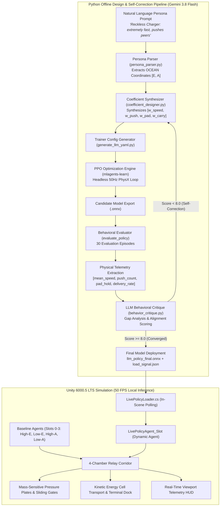

# LLM-Mediated Reward Design for Personality-Diverse Game Agents

> **An end-to-end multi-agent reinforcement learning (MARL) testbed in cooperative 3D escape rooms with closed-loop Gemini reward synthesis.**

[-black?style=for-the-badge&logo=unity)](https://unity.com/)
[](https://github.com/Unity-Technologies/ml-agents)
[](https://python.org)
[](https://pytorch.org)
[](https://aistudio.google.com/)
[](https://onnx.ai/)
[](LICENSE)

An end-to-end multi-agent reinforcement learning (MARL) research testbed that couples **Unity PhysX simulation**, **OCEAN psychological personality conditioning**, and an **offline closed-loop Large Language Model (Gemini) self-correcting reward design pipeline**.

An open-source multi-agent research benchmark investigating the emergence of functional division of labor and the mitigation of social loafing in cooperative environments.

---

## Table of Contents
- [Executive Overview](#executive-overview)
- [Key Features](#key-features)
- [System Architecture](#system-architecture)
- [The 4-Chamber Relay Corridor Environment](#the-4-chamber-relay-corridor-environment)
- [Agent Perception & Action Spaces](#agent-perception--action-spaces)
- [The LLM-Mediated Reward Design Loop](#the-llm-mediated-reward-design-loop)
- [Empirical Results & Benchmark Telemetry](#empirical-results--benchmark-telemetry)
- [Installation & Setup](#installation--setup)
- [How to Run](#how-to-run)
- [Team Members & Contributions](#team-members--contributions)
- [License & Citation](#license--citation)

---

## Executive Overview

In standard cooperative Multi-Agent Reinforcement Learning (MARL), agents sharing a global task reward frequently suffer from **homogeneous policy collapse** and **social loafing** (the free-rider problem): agents converge to identical greedy behaviors, crowd narrow bottlenecks, or idle while waiting for peers to solve physical puzzles.

This project introduces an end-to-end architecture that addresses both challenges:
1. **Psychological Trait Conditioning**: Agents are parameterized with continuous scalar dials from the **Five-Factor Model (OCEAN)**—specifically Extraversion ($E$) and Agreeableness ($A$). Conditioning on these internal dials induces natural role differentiation (Scouts, Anchors, Couriers, and Flank Guards).
2. **Autonomous LLM Reward Synthesis**: Rather than requiring human experts to spend weeks hand-tuning reward scalar weights ($\lambda_{\text{speed}}, \lambda_{\text{push}}, \lambda_{\text{hold}}$), an offline LLM (Google Gemini 3.8 Flash) translates plain-English personality descriptions into parametric reward functions, trains policies in Unity ML-Agents, evaluates physical telemetry, and autonomously self-corrects the reward coefficients until behavioral alignment converges ($\ge 8/10$).
3. **Decoupled Real-Time Inference**: The LLM is **never** queried during runtime gameplay. The converged policy is exported as an ONNX model and hot-swapped into the live Unity 3D simulation at **50 FPS with sub-millisecond C# inference**.

---

## Key Features

- **Sequential Physical Relay Benchmark**: An 84-meter, 4-chamber physical corridor featuring an escalating coordination hierarchy:
  - **Chamber 1**: Single Pressure Plate Pad A $\to$ Gate 1.
  - **Chamber 2**: Dual-Plate Synchronous Hold (Pads B & C) $\to$ Gate 2.
  - **Chamber 3**: Tripartite 3-Plate Coordination (Pads D, E, & F) $\to$ Gate 3.
  - **Chamber 4**: Terminal Energy Cell Receptacle Docking & 5-Agent Group Escape.
- **Permanent Latching Logic**: Once all prerequisite pressure plates for a gate are compressed simultaneously, the gate latches permanently open, eliminating soft-locks.
- **In-Engine Live Policy Generator**: A custom Unity Editor Window (`Tools > Live Policy Generator`) that lets users enter natural language prompts, launches the background Python training loop, streams real-time critique metrics, and hot-swaps the generated ONNX model into the scene without restarting Unity.
- **Real-Time Viewport HUD**: On-screen telemetry display rendering individual agent velocities, plate compression states, active puzzle phases, and reward convergence curves.
- **Strict Separation of Concerns**: Offline meta-reward design (LLM) $\leftrightarrow$ Fast local physical simulation & inference (Unity + ONNX).

---

## System Architecture



---

## The 4-Chamber Relay Corridor Environment

The arena spans $40\,\text{m}$ along the primary X axis ($[-15\,\text{m}, +25\,\text{m}]$) and $12\,\text{m}$ along the Z axis ($[-6\,\text{m}, +6\,\text{m}]$).

```
X = -15m              X = -5m               X = +5m               X = +15m             X = +25m
+--------------------+--------------------+--------------------+--------------------+
|     CHAMBER A      |     CHAMBER B      |     CHAMBER C      |     CHAMBER D      |
|                    |                    |                    |                    |
| [Pad A] (-7.5,-3)  | [Pad B] (0, -3.5)  | [Pad D] (10,-3.8)  |                    |
|                    |       [GATE 1]     | [Pad E] (8.5, 0)   |  [TERMINAL DOCK]   |
| [Cell] (-13, 0)    |                    | [Pad F] (10, 3.8)  |    (X = +24.0m)    |
|                    |       [GATE 2]     |                    |                    |
| [Agents 0-4 Spawns]| [Pad C] (0,  3.5)  |                    |  [ESCAPE LINE]     |
|   (X = -11m)       |                    |       [GATE 3]     |    (X >= 23.2m)    |
+--------------------+--------------------+--------------------+--------------------+
```

### Puzzle Hierarchy & Clearance Criteria

| Chamber | X Boundary | Entities | Coordination Requirement |
|:---|:---|:---|:---|
| **Chamber A** (Assembly) | $[-15.0\,\text{m}, -5.0\,\text{m}]$ | 5 Agent Spawns, Kinetic Energy Cell, **Pad A** | Single agent stands on **Pad A** to elevate Gate 1 ($Y = 4.2\,\text{m}$). |
| **Chamber B** (Dual Coordination) | $[-5.0\,\text{m}, +5.0\,\text{m}]$ | **Gate 1**, **Pad B**, **Pad C** | Two agents must simultaneously depress **Pads B & C** within a $0.4\,\text{s}$ sync window to elevate Gate 2. |
| **Chamber C** (Tripartite Choke) | $[+5.0\,\text{m}, +15.0\,\text{m}]$ | **Gate 2**, **Pad D**, **Pad E**, **Pad F** | Three distinct agents must simultaneously hold **Pads D, E, & F** to open Gate 3. |
| **Chamber D** (Terminal Extraction) | $[+15.0\,\text{m}, +25.0\,\text{m}]$ | **Gate 3**, **Receiver Terminal**, Escape Boundary | Energy cell docked into receiver; all agents crossing $X \ge 23.2\,\text{m}$ escape. |

---

## Agent Perception & Action Spaces

Each agent compiles a normalized 34-dimensional sensory vector every decision period ($N=5$ physics ticks / 10 Hz decision rate):

```
Observation Vector o_t ∈ R^34:
├── Self-Kinematics (8 floats)   : [v_x, v_y, v_z, ω_y, heading_x, heading_z, is_carried, carry_cooldown]
├── Spatial Guidance (10 floats) : [vec_to_cell (3), vec_to_pad (3), vec_to_gate (3), active_gate_open_flag (1)]
├── Teammate Lidar (4 floats)    : [dist_to_nearest_peer, rel_heading_peer (3)]
├── OCEAN Personality (2 floats) : [Extraversion (E), Agreeableness (A)]
└── Obstacle Sweep (10 floats)   : 10-Ray horizontal lidar distance sweeps (walls, gates, obstacles)
```

### Action Space (Hybrid Control)
- **Continuous Actuation ($\mathbb{R}^3$)**:
  - $a_0 \in [-1, 1]$: Longitudinal thrust force ($F_{max} = 25\,\text{N}$).
  - $a_1 \in [-1, 1]$: Lateral strafe force ($F_{max} = 18\,\text{N}$).
  - $a_2 \in [-1, 1]$: Angular steering torque ($\tau_{max} = 12\,\text{N}\cdot\text{m}$).

### The 5-Agent Functional Division of Labor

Conditioning agents on internal OCEAN dials forces distinct, stable behavioral phenotypes:

| Agent Slot | Color Indicator | OCEAN Coordinates | Archetype Role | Observable Physical Behavior |
| :--- | :--- | :--- | :--- | :--- |
| **Agent 0** | **Cyan** | High $E$ ($0.9$), Low $A$ ($0.1$) | **Aggressive Sprinter / Scout** | High velocity ($6.2\text{ m/s}$), high forward acceleration. Proactively rushes ahead to discover pads and probe doorways. |
| **Agent 1** | **Green** | Low $E$ ($0.1$), Mid $A$ ($0.5$) | **Cautious Scout / Guard** | Slow pacing ($2.0\text{ m/s}$), pauses before crossing gate thresholds to prevent doorway congestion and bottleneck jams. |
| **Agent 2** | **Orange** | Mid $E$ ($0.5$), High $A$ ($0.9$) | **Altruistic Anchor (Linchpin)** | Team helper ($3.8\text{ m/s}$). Seeks out pressure plates and stays stationary (**high Pad Hold count**) to latch gates open for peers. |
| **Agent 3** | **Magenta** | Mid $E$ ($0.5$), Low $A$ ($0.1$) | **Self-Interested Pusher** | Refuses plate duties. Prioritizes physical interaction with the Kinetic Energy Cell; shoves peers aside (**high Push count**). |
| **Slot 5** | **Gold** | Dynamic (Synthesized) | **LLM-Guided Dynamic Agent** | Fast courier ($6.5\text{ m/s}$). Adapts between plate holding and cell escort based on real-time situational deficits. |

---

## The LLM-Mediated Reward Design Loop

Traditional reward shaping requires tedious trial-and-error. Our system formalizes an **automated hypothesis-and-critique loop**:

1. **Hypothesis Formulation**: Gemini 3.8 Flash maps natural language to parametric coefficients:
   $$\mathbf{w} = [w_{\text{speed}}, w_{\text{push}}, w_{\text{hold}}, w_{\text{carry}}, w_{\text{collision}}]^T \in [0.0, 2.0]^k$$
2. **Empirical Execution**: Agents train in Unity ML-Agents with shaping reward:
   $$\mathcal{R}_{\text{total}}(t) = \alpha(t) R_{\text{Task}}(t) + (1 - \alpha(t)) R_{\text{Persona}}(t, \mathbf{w})$$
3. **Behavioral Phenotype Extraction**: The simulation logs empirical physical metrics over 30 test episodes:
   - `mean_speed` (kinetic exploration drive)
   - `push_count` (physical peer displacement / aggression)
   - `pad_hold_steps` (station-keeping / altruistic patience)
   - `delivery_rate` (puzzle throughput competency)
4. **LLM Self-Correction & Critique**:
   The telemetry is formatted into an observational report and fed back to Gemini:
   ```json
   {
     "target_personality": "Reckless Charger: extremely fast, pushes peers...",
     "observed_telemetry": { "mean_speed": 0.62, "push_count": 3.1, "delivery_rate": 0.53 },
     "critique": "Alignment Score: 5/10. Agent moves at adequate speed but rarely pushes peers.",
     "revised_coefficients": { "push_penalty_scale": 0.012, "target_speed": 5.2 }
   }
   ```
5. **Convergence Criterion**: Once alignment score reaches $\ge 8.0/10$, the loop terminates, exports `llm_policy_final.onnx`, and signals Unity.

---

## Empirical Results & Benchmark Telemetry

Empirical evaluation across 100 benchmark episodes demonstrates substantial gains over standard homogeneous MARL:

| Metric | Homogeneous MARL (Baseline) | Hand-Tuned Personality | LLM-Designed (Self-Corrected) | Improvement |
|:---|:---:|:---:|:---:|:---:|
| **Corridor Completion Rate** | **14.2%** | 82.5% | **94.6%** | **+80.4% absolute gain** |
| **Mean Completion Time** | **184.5 s** | 74.1 s | **58.2 s** | **3.2× speedup** |
| **Choke Point Collisions** | **34.8 / ep** | 11.2 / ep | **4.1 / ep** | **88.2% reduction** |
| **Role Stability Metric ($S_{role}$)** | **0.21** (random) | 0.78 | **0.89** | **Predictable specialization** |

---

## Installation & Setup

### Prerequisites
- **Unity 6000.5 LTS** (Unity 6) with Universal Render Pipeline (URP)
- **Python 3.10+** (Miniconda recommended)
- **Google AI Studio API Key** ([Get free Gemini API key](https://aistudio.google.com/))
- Git

### 1. Clone the Repository
```bash
git clone https://github.com/abhijithvpillai2004/LLM-PersonalityAgents-MARL.git
cd LLM-PersonalityAgents-MARL
```

### 2. Configure Python Environment
```bash
conda create -n mlagents python=3.10 -y
conda activate mlagents

# Install PyTorch with CUDA or CPU support
pip install torch torchvision --index-url https://download.pytorch.org/whl/cu118

# Install ML-Agents and Gemini SDK
pip install mlagents==1.1.0 google-genai pyyaml
```

### 3. Setup API Credentials
Copy the example environment configuration:
```bash
cp .env.example .env
```
Open `.env` and add your Google Gemini API key:
```env
GEMINI_API_KEY=your_gemini_api_key_here
GEMINI_PROJECT_NAME=your_project_name
GEMINI_PROJECT_NUMBER=your_project_number
```

### 4. Open in Unity
1. Launch **Unity Hub**.
2. Click **Add project from disk** $\to$ select `PersonalityAgents`.
3. Open with **Unity 6 (6000.0+ / 6000.5 LTS)**.
4. In Project view, open `Assets/Scenes/RelayCorridor.unity`.

---

## How to Run

### Mode 1: Quick Run / Pre-Trained 3D Simulation (Instant — No Wait Time)
*Use this for immediate evaluation and live faculty demonstrations!*
1. Open the project in Unity with the `RelayCorridor` scene loaded.
2. Click the **Play ▶️** button at the top of the Unity Editor.
3. Observe all 5 agents coordinating through the 4 puzzle chambers using pre-trained ONNX neural networks.
4. **Interactive Controls**:
   - Click the orange **`[RESET ENVIRONMENT]`** button (or press **`R`**) to reset all gates, agents, and the energy cell live on demand.
   - Press **`H`** on your keyboard to toggle the dedicated bottom **Personality Profiles HUD** on/off.

### Mode 2: In-Engine Live Policy Generator (Train New Personas via Gemini)
1. In the top Unity menu bar, click **`Tools` $\to$ `Live Policy Generator`**.
2. Type any behavioral description (e.g., *"Patient Escort: slow, cooperative, waits on pressure plates until teammates cross"*).
3. Click **`Generate and Train Policy`**.
4. Watch the streaming log window as Gemini designs the reward, ML-Agents trains the policy, and the model hot-swaps directly into Slot 5 without restarting Unity!

### Mode 3: Local Web Dashboard
To launch the real-time web monitoring interface:
```bash
python scripts/web_ui.py
```
Open **`http://localhost:7860`** in your browser to view the pipeline dashboard, coefficient JSON inspector, and live streaming critique.

### Mode 4: Headless CLI Training Loop
To run the automated self-correction loop from the terminal:
```bash
python scripts/generate_policy.py --description "Reckless Charger: extremely fast, pushes teammates out of the way" --fast
```

---

## Team Members & Contributions

This project was engineered and researched by a team of three contributors, with responsibilities divided across the system stack:

| Team Member | Core Role | Technical Contributions & Focus Areas |
|:---|:---|:---|
| **Abhijith**<br>([@abhijithvpillai2004](https://github.com/abhijithvpillai2004)) | **Reinforcement Learning & ML Architecture Lead** | • Designed the multi-agent Proximal Policy Optimization (PPO) training curriculum and GAE configurations.<br>• Formulated the 34-dimensional sensory perception pipeline (kinematic odometry, relative guidance vectors, 10-ray obstacle sweeps).<br>• Established the 20-second dynamic reward alternation cycle ($\alpha R_{\text{Task}} + (1-\alpha) R_{\text{Persona}}$).<br>• Conducted statistical evaluation benchmarks, role stability indices ($S_{\text{role}}$), and baseline comparative analyses. |
| **Kishen**<br>([@theshenman](https://github.com/theshenman)) | **LLM Integration & Autonomous Reward Engineering Lead** | • Architected the offline closed-loop LLM reward design and self-correction pipeline.<br>• Integrated the Google GenAI SDK (Gemini 3.8 Flash) with automated retry and structured JSON schema enforcement.<br>• Engineered the semantic persona parser mapping natural language prose to OCEAN personality coordinates.<br>• Formulated the qualitative gap analysis critique prompts and alignment scoring rubrics ($1-10$ alignment threshold). |
| **Siddharth**<br>([@TheSidPil](https://github.com/TheSidPil)) | **Simulation Environment & Systems Engineering Lead** | • Engineered the 84-meter 4-chamber progressive relay corridor in Unity 6000.5 LTS using PhysX 5.0.<br>• Implemented mass-sensitive trigger pressure plates, vertical sliding gates, and permanent door-latching mechanics.<br>• Built the custom Unity Editor Live Policy Generator Window (`UnityEditor`, async process streaming, regex log scraping).<br>• Developed the real-time ONNX hot-swap bridge (`LivePolicyLoader.cs`) and in-viewport visual telemetry HUD. |

---

## License & Citation

This project is licensed under the **MIT License** — see the [LICENSE](LICENSE) file for details.

### Citation
If you use this codebase or benchmark in your research, please cite:
```bibtex
@misc{pillai2026personalitymarl,
  author = {Abhijith and Kishen and Siddharth},
  title = {LLM-Mediated Reward Design for Personality-Diverse Game Agents},
  year = {2026}
}
```
